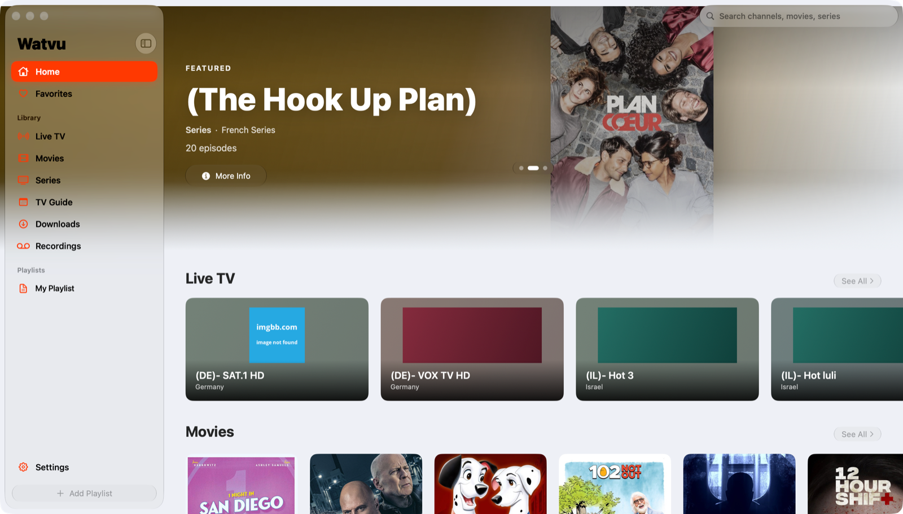
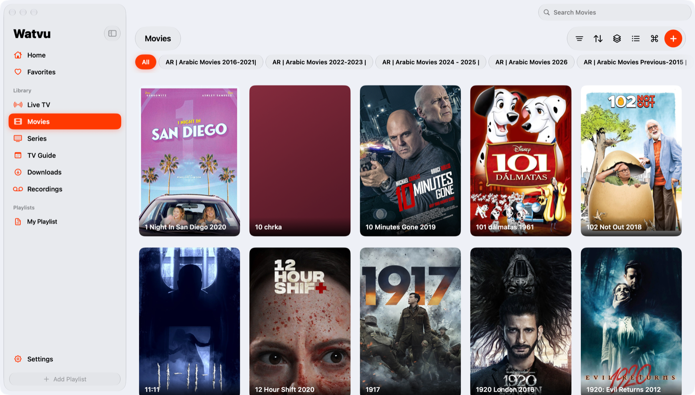
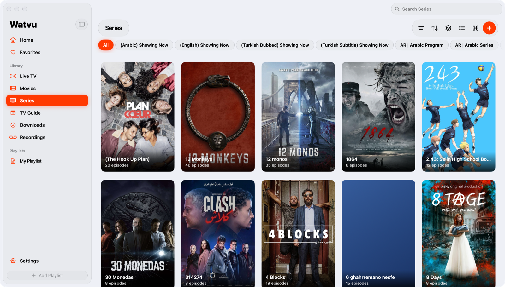

<p align="center">
  
</p>

<h1 align="center">Watvu</h1>

<p align="center">A native macOS IPTV client, built in SwiftUI for macOS 26.</p>



Watvu is a player only. It includes no channels or content: you add playlists and
services you already have, and your library stays on your Mac.

## Screenshots

| Movies | Series |
|---|---|
|  |  |

## Features

**Sources**
- M3U / M3U8 from a URL or a local file, including stream headers and catch-up attributes
- Xtream Codes: live, movies, series and archive catch-up
- Plex, Jellyfin and Emby servers
- Add a playlist from your phone by scanning a QR code

**Library**
- Home page with featured items and Live TV, Movies and Series shelves
- M3U episodes grouped into one card per show, with seasons
- Filters, sorting, search, favorites lists and resume positions
- Built for big playlists: tested with 300,000+ items

**TV guide**
- XMLTV sources, including gzip, in list and timeline views
- Now and Next, programme details, reminders and manual channel mapping

**Playback**
- Custom player controls with audio and subtitle tracks, speed, aspect modes and subtitle delay
- Picture in Picture, AirPlay, Google Cast and Multiview
- Downloads and recordings
- Optional mpv engine, if `libmpv` is installed

**More**
- TMDB artwork and details, Trakt and OpenSubtitles
- iCloud Drive sync and backups
- Passwords kept in the Keychain

## Requirements

- macOS 26 or later
- Swift toolchain: the Command Line Tools are enough, Xcode isn't required

## Build and run

```bash
./scripts/build-app.sh
```

```bash
open Watvu.app
```

The app is ad-hoc signed and written to `Watvu.app`. On first launch, the welcome
screen helps you add a playlist or service, or you can choose **Add later**.

## Tests

```bash
./scripts/test-core.sh
```

The script compiles the parsers, models and clients into a standalone test program,
because the Command Line Tools don't include XCTest.

## Project status

Watvu is in active development. These features are written but haven't been fully
tested against real services yet:

- Google Cast playback on a TV
- Plex, Jellyfin and Emby (tested against a local mock server only)
- The mpv engine
- TMDB and Trakt, and iCloud sync between two Macs
- Multiview

Known issues:

- Trakt doesn't renew its access token yet.
- Stream addresses often include the provider's login, and these are saved as plain
  text in the library files under `~/Library/Application Support/Watvu`.

## Project layout

- `Sources/Watvu`: the app
- `Tests/CoreTests`, `Tests/Fixtures`: core tests and sample data
- `scripts`: app packaging and test scripts
